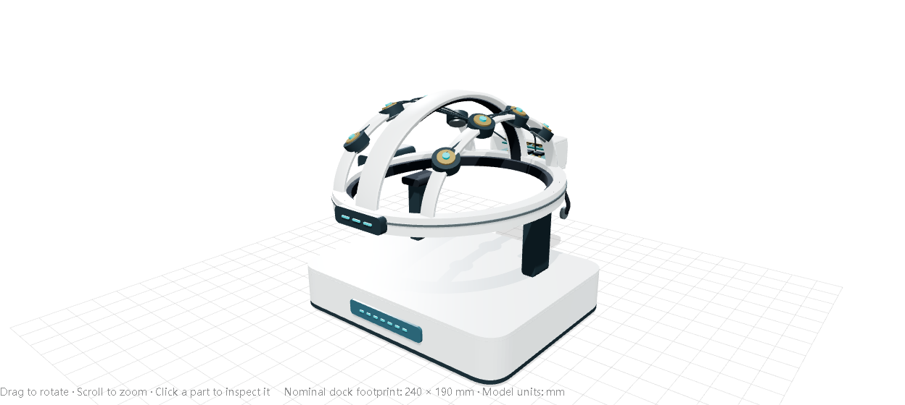
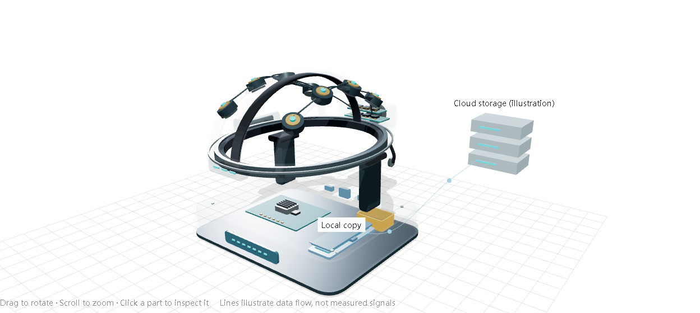
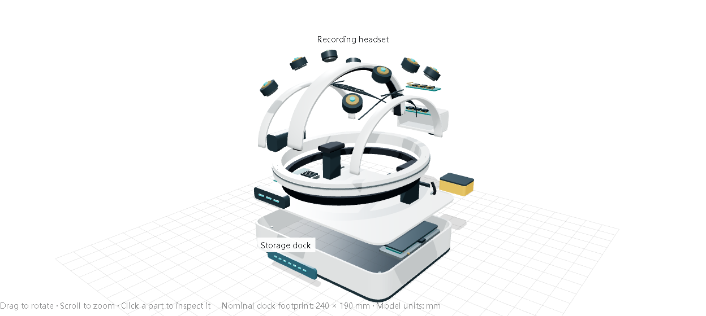

# CONTINUUM C1

CONTINUUM C1 is a 3D concept model of an eight-channel EEG headset and a desktop storage dock. Explore how scalp signals would travel from the electrodes to the dock, inspect the proposed electronics, or take the assembly apart on screen.

**Design version:** v0.1 · October 24, 2026

**[Download the complete model and offline viewer](https://github.com/cjgogo27/CONTINUUM/raw/refs/heads/main/continuum-c1-model.zip).** Extract the archive and open `continuum-c1/interactive-model.html` in a desktop browser with WebGL support. No installation, account or internet connection is required. GitHub's HTML file view displays the source; open the downloaded file to use the viewer.

Drag to rotate, scroll to zoom, and select a part to see its materials and purpose. The **View** menu switches between the assembly, exploded view, transparent housing, headset fit and **How it works**. In the exploded view, the spacing slider separates the components. In **How it works**, the data path menu highlights the parts involved at each step.

## What the model shows

1. Eight scalp electrodes and a pair of reference/bias contacts provide the proposed signal inputs.
2. A shielded harness leads to the analog front end and analog-to-digital converter (ADC).
3. The headset controller would timestamp and buffer the samples, then transmit them wirelessly.
4. The dock would verify and encrypt the samples before writing them to removable storage.
5. The network port represents a path for synchronizing encrypted recordings and model files to cloud storage.

The lines, moving dots and server icon illustrate this design; the viewer does not collect or upload data. **The model does not read, encode, transfer or restore consciousness.** The dashed line at the final step marks an open research question. The reserved bay (D09) is physically empty in the design.

## Assembly and materials

The assembly contains **30 component groups, 143 meshes and 27,992 triangles**.

| Group | Parts | Proposed materials |
| --- | --- | --- |
| H01–H12 · Headset | Headband, liner, crown arch, rails, wiring, electronics enclosure, electronics, battery, adjustment dial and status strip | PC-ABS, aluminum alloy, silicone or foam, FR-4 |
| E01–E09 · Contacts | Eight sensing electrode modules and one reference/bias assembly with two contacts | Silver/silver chloride (Ag/AgCl) contact placeholders and insulating mounts |
| D01–D09 · Dock | Housing, lid, cradle, receiver board, storage carrier, ports, status panel, feet and reserved bay | PC-ABS, aluminum, FR-4 and silicone |

## Model files

| File | Contents |
| --- | --- |
| [Offline viewer](continuum-c1/interactive-model.html) | Self-contained interactive model |
| [Assembly GLB](continuum-c1/continuum-c1-assembly.glb) · [Exploded GLB](continuum-c1/continuum-c1-exploded.glb) | Named components with material and function metadata; the exploded file uses 70% spacing |
| [OBJ geometry](continuum-c1/continuum-c1.obj) · [MTL materials](continuum-c1/continuum-c1.mtl) | Keep the two files together; select millimeters on import |
| [Model source](continuum-c1/c1-model.js) · [Viewer template](continuum-c1/viewer-source.html) | Procedural geometry and interface source |
| [Component catalog](continuum-c1/components.json) | Part IDs, names, materials, functions, nominal sizes, measured bounds and explosion offsets |
| [Design notes](continuum-c1/design-notes.txt) | Dimensions, operating concept, proposed materials and fabrication limits |
| [Validation record](continuum-c1/validation.json) | File, geometry and viewer checks |
| [Third-party notices](continuum-c1/THIRD-PARTY-NOTICES.txt) | Credits and license for the bundled Three.js code |

## Scale and editing

X runs left to right, Y points up and +Z points toward the wearer's front. The source, OBJ and catalog use millimeters. Both GLBs use meters, with a root scale of 0.001.

| Envelope (X × Y × Z) | Dimensions |
| --- | --- |
| Headset | 225.1 × 121.5 × 284.7 mm |
| Dock, including cradle and exposed connectors | 240 × 118 × 196.7 mm |

The dock housing has a nominal footprint of 240 × 190 mm. These are model dimensions, not validated fit requirements. The source entry point, `createContinuumC1(THREE)`, returns the assembly root, headset, dock and component groups. The viewer template contains insertion points for the libraries and model code. After editing the source, rebuild the standalone viewer and re-export the affected model files to see the changes.

## Fabrication limits

This model supports design review and mechanical layout. It is not production CAD: the meshes may overlap, and mounting features, tolerances, thermal performance and strength have not been engineered for printing or assembly. There are no PCB schematics, protective battery circuit, firmware, encryption implementation or cloud service. Do not connect the placeholder electronics, electrodes or battery to a person. The validation record covers digital files and viewer behavior only.

## References and licensing

- [OpenBCI Cyton hardware documentation](https://docs.openbci.com/Cyton/CytonSpecs/) informed the signal-acquisition concept.
- [Eon Systems: Embodied Brain Emulation](https://eon.systems/updates/embodied-brain-emulation) provides research context for brain emulation. It does not validate consciousness transfer in this device.
- The viewer embeds [Three.js](https://github.com/mrdoob/three.js) 0.128.0 and its OrbitControls, GLTFExporter and STLExporter utilities under the MIT license. See the [third-party notices](continuum-c1/THIRD-PARTY-NOTICES.txt).

The C1 geometry and presentation were created for this project. The repository does not specify a separate open-source license for the original model.
