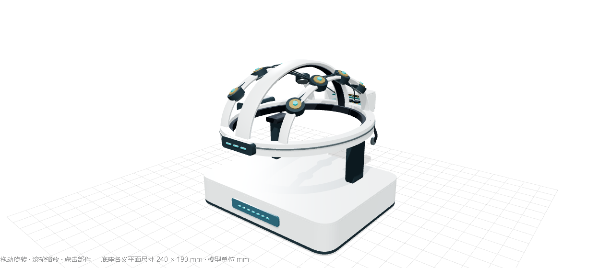
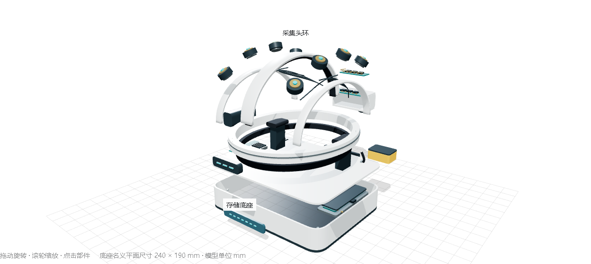
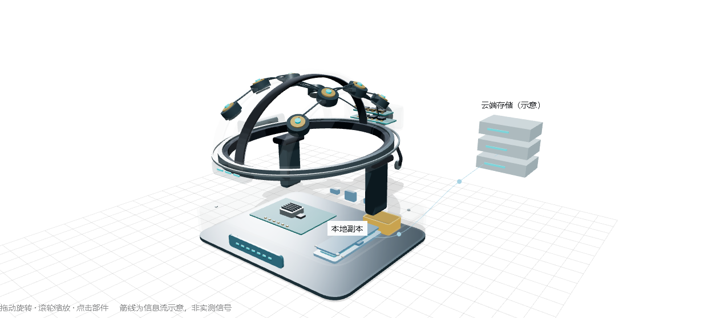

# CONTINUUM · 续存 C1

面向神经信号采集、数字化、传输与存储的三维硬件概念设计。包含头戴装置、桌面存储底座、内部组件、爆炸视图和交互式作用机理展示。

**版本：v0.1 · 2026-10-24**

> 本项目是一套三维概念装配，并未实现意识读取、上传、转移或恢复。模型中的云端表示数据存储；“意识重建”被明确标为尚未实现的研究问题。电子板、芯片和电池为布局占位，不代表已完成的电路设计。

## 打开模型

1. [下载完整模型包](https://github.com/cjgogo27/CONTINUUM/raw/refs/heads/main/continuum-c1-model.zip)，解压。
2. 用支持 WebGL 的桌面浏览器打开 `continuum-c1/interactive-model.html`。
3. 拖动旋转、滚轮缩放，切换整体装配、模块分解、外壳透视、佩戴关系、作用机理；点击部件查看材料与作用。

离线预览已内嵌所需脚本，无需安装或联网。GitHub 文件页面显示 HTML 源码，下载后才能直接运行。预览没有接入真实采集设备或云端服务。

## 文件导航

| 文件 | 用途 |
| --- | --- |
| [离线交互预览](continuum-c1/interactive-model.html) | 可旋转、缩放、分解并查看信息流的三维界面 |
| [完整装配 GLB](continuum-c1/continuum-c1-assembly.glb) | 含组件名称、材料及功能元数据 |
| [分解装配 GLB](continuum-c1/continuum-c1-exploded.glb) | 固定为 70% 分解量 |
| [OBJ 几何](continuum-c1/continuum-c1.obj) / [MTL 材质](continuum-c1/continuum-c1.mtl) | 导入时将两者放在同一目录，指定毫米 |
| [建模源码](continuum-c1/c1-model.js) | 程序化生成几何、材料与组件结构 |
| [界面源码模板](continuum-c1/viewer-source.html) | 包含脚本插入占位符，不能单独运行 |
| [组件清单](continuum-c1/components.json) | 30 个逻辑组件的材料建议、尺寸、作用和分解偏移 |
| [完整设计说明](continuum-c1/design-notes.txt) | 结构、材料、作用机理、使用方式与制作边界 |
| [验证记录](continuum-c1/validation.json) | 文件结构、几何有效性和界面检查结果 |
| [第三方声明](continuum-c1/THIRD-PARTY-NOTICES.txt) | 内嵌 Three.js 及其工具的 MIT 许可声明 |

## 结构与材料

全模型包含 **30 个逻辑组件、143 个网格、27,992 个三角面**。

| 模块 | 组成 | 概念材料 |
| --- | --- | --- |
| 头戴结构 H01–H12 | 头环、软衬、拱梁、导轨、电子舱、调节件及电路占位 | PC-ABS、铝合金、硅胶/泡棉、FR-4 |
| 接触组件 E01–E09 | 8 个信号接触组件，以及包含 2 个接触件的参考/偏置组件 | 银/氯化银接触件占位 |
| 桌面底座 D01–D09 | 壳体、支架、接收处理板、可移除存储、接口和未来研究接口空位 | PC-ABS、FR-4、硅胶/泡棉 |

## 作用机理

设计意图为：**头皮电位差 → 模拟前端与 ADC → 时间标记和无线传输 → 校验、加密与本地存储 → 云端数据同步**。

交互预览逐步高亮相关组件，并用示意信息流连接头戴装置、底座与云端图标。曲线、粒子与云端图标均为可视化示意，不是实测信号或已经运行的远程服务。

“全脑状态读取、意识编码与主体连续性”没有已实现模块。D09 保留为空白研究接口，不能据此推导出意识转移已经可行。

## 尺寸与开发说明

- 坐标：X 为左右，Y 向上，+Z 为佩戴者前方。
- 源码、OBJ 和组件清单使用毫米；GLB 使用米，通过根节点缩放 0.001 转换。
- 头戴部分包围盒约为 **225.1 × 121.5 × 284.7 mm**（X/Y/Z）。
- 底座含支架与外露接口的包围盒约为 **240 × 118 × 196.7 mm**（X/Y/Z）；壳体名义平面尺寸为 240 × 190 mm。
- `createContinuumC1(THREE)` 返回 `root`、`headset`、`dock`、`parts` 等对象；本版使用 Three.js 0.128.0。
- 修改建模源码后须重新生成并导出模型，现有 GLB 和离线预览不会自动更新。
- `viewer-source.html` 中的 `C1_LIBRARIES` 和 `C1_MODEL` 是构建插入点；可直接运行的成品是 `interactive-model.html`。

## 制作与验证边界

当前文件适合外观讨论、结构布局沟通和后续机械设计。它不是 STEP/B-rep 工程 CAD，没有完成连接结构、装配公差、强度、散热、PCB、固件、电气安全或云端软件设计；相邻网格可能重叠，不能直接视为可打印装配件。

已有验证覆盖 GLB/OBJ 文件结构、有限坐标、索引有效性，以及五种界面模式与部件选择交互；没有进行物理、电气、医学或意识转移验证。不要将占位电子舱、电极或电池模块直接接入人体。

## 参考与第三方软件

- [OpenBCI Cyton 硬件文档](https://docs.openbci.com/Cyton/CytonSpecs/)：神经信号采集硬件的参考。
- [Eon — Embodied Brain Emulation](https://eon.systems/updates/embodied-brain-emulation)：脑模拟研究方向的参考，不构成本设备能转移意识的证据。
- [Three.js](https://github.com/mrdoob/three.js)：离线预览使用 0.128.0 及 OrbitControls、GLTFExporter、STLExporter，许可见[第三方声明](continuum-c1/THIRD-PARTY-NOTICES.txt)。

设备几何与展示为本项目创建的概念设计，并非上述项目产品的复刻。第三方软件的 MIT 许可范围见相应声明；本仓库尚未为原创模型单独指定开源许可证。